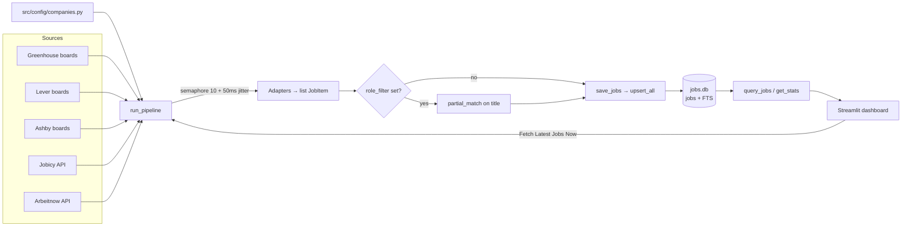
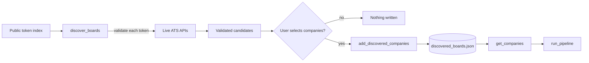

# Architecture

This page describes how the pipeline moves data from public job APIs to the
Streamlit dashboard, and the rules that keep it deduplicated and searchable.

## Component map

| Component | File | Responsibility |
| --- | --- | --- |
| Entry point / orchestrator | `src/pipeline.py` | Builds tasks, enforces concurrency, aggregates results, saves jobs, returns stats. |
| CLI | `src/pipeline.py` (`__main__`) | Runs one full pipeline and prints the stats dict. |
| Discovery CLI | `src/discover_boards.py` | Lists validated board candidates and saves explicitly selected companies. |
| Dashboard | `src/app.py` | Filters the database, shows metrics, triggers live fetches, runs opt-in discovery, exports CSV/JSON. |
| Source config | `src/config/companies.py` | Curated board tokens, discovery-cache merge/save, and India/Hyderabad keyword lists. |
| Board discovery | `src/scrapers/discovery.py` | Loads a public token index and validates candidate boards against live ATS APIs. |
| ATS adapters | `src/scrapers/{greenhouse,lever,ashby}.py` | One company board → `list[JobItem]`. |
| Free API adapters | `src/scrapers/free_apis.py` | Jobicy and Arbeitnow feeds → `list[JobItem]`. |
| Shared scraper helpers | `src/scrapers/utils.py` | Deterministic job IDs, user agents, location classification. |
| Domain model | `src/db/models.py` | Pydantic `JobItem` and its defaults. |
| Persistence | `src/db/storage.py` | Schema creation, FTS index, upsert, query, aggregate stats. |
| Search | `src/db/search.py` | Token-aware partial matching, also exposed to SQLite as a UDF. |

## End-to-end flow



### Company discovery flow (opt-in)



Discovery is deliberately split into two steps. `discover_boards()` performs
network reads and returns candidates but never touches configuration.
`add_discovered_companies()` is the only write path and persists just the
companies the user selected. It reads the cache strictly, merges without
duplicating tokens, and replaces the file atomically.

### 1. Task creation

`run_pipeline()` opens one shared `httpx.AsyncClient` and creates a task for
every configured company board, plus one task each for Jobicy and Arbeitnow.
Each task is wrapped in a semaphore-limited helper that sleeps 50 ms before the
request.

### 2. Request execution

- At most **10** requests run concurrently (`asyncio.Semaphore(10)`).
- Client-level connection limits: 20 keep-alive, 30 total.
- Client timeout: 15 s; each adapter also passes a 12 s timeout.
- Each adapter uses one of three browser-like User-Agent strings.
- A non-200 response returns an empty list for that board.
- Exceptions are caught per adapter, logged at `DEBUG`, and converted to an
  empty list. One broken token cannot abort the run.

### 3. Normalization

Every adapter maps its payload into `JobItem` and classifies location with
`check_location(location, title)`. Ashby additionally concatenates
`secondaryLocations` before classification. Descriptions are truncated to 2,000
characters where the API provides one.

### 4. Aggregation and optional filtering

Results are collected with `asyncio.as_completed()`. If `role_filter` is
provided, jobs are kept only when
`partial_match(role_filter, job.title)` is true. The Streamlit live-fetch button
passes `role_filter=None`, so the dashboard sees the full fetch and filters in
SQL afterward.

### 5. Persistence

`save_jobs()` converts booleans to `0/1`, then calls
`db["jobs"].upsert_all(records, pk="id")`. Existing IDs are updated; new IDs are
inserted. The return value is the number of records processed, not the number of
new rows.

### 6. Read path

The dashboard calls `query_jobs()` with the sidebar filters and
`get_stats()` for the metric cards. `get_stats()` returns total jobs, India
count, Hyderabad count, and distinct companies. Source and company dropdown
options come from `SELECT DISTINCT` queries against `jobs`.

## Data model

Table `jobs` (created automatically by `get_db()`):

| Column | Type | Notes |
| --- | --- | --- |
| `id` | TEXT, primary key | Stable per posting; see [Job IDs](#job-ids-and-deduplication). |
| `source` | TEXT | `Greenhouse`, `Lever`, `Ashby`, `Jobicy`, or `Arbeitnow`. |
| `company` | TEXT | Company display name from config or the API feed. |
| `title` | TEXT | Job title. |
| `location` | TEXT | Raw location string from the API. |
| `is_india` | INTEGER | `1`/`0`, derived by `check_location()`. |
| `is_hyderabad` | INTEGER | `1`/`0`, derived by `check_location()`. |
| `job_type` | TEXT | Employment type where supplied; defaults to `Full-time`. |
| `url` | TEXT | Direct application/listing URL. |
| `description` | TEXT | Up to 2,000 characters; empty for Ashby and Arbeitnow. |
| `salary` | TEXT | Declared in the model but not populated by any adapter. |
| `posted_date` | TEXT | Source-specific format; see below. |
| `created_at` | TEXT | UTC ISO timestamp refreshed on every upsert (effectively "last seen"). |

`posted_date` is intentionally not normalized: Greenhouse uses `updated_at`,
Lever stringifies `createdAt`, Ashby uses `publishedAt`, Jobicy uses `pubDate`,
and Arbeitnow stringifies `created_at`. Treat it as display-only unless you add
normalization.

An FTS5 index named `jobs_fts` covers `title`, `company`, `location`, and
`description`, with insert/update/delete triggers. The current `query_jobs()`
search path uses the `partial_match` SQLite function instead of FTS; the index
is available for future/ad-hoc full-text queries.

## Job IDs and deduplication

Native source IDs are preferred so a posting keeps its identity across runs:

| Source | ID format |
| --- | --- |
| Greenhouse | `gh_<board_token>_<greenhouse_job_id>` |
| Lever | `lever_<board_token>_<lever_posting_id>` |
| Ashby | `ashby_<board_token>_<ashby_job_id>` |
| Jobicy | `jobicy_<jobicy_id>` |
| Arbeitnow | `arbeitnow_<slug>` |

If the source does not provide an ID, the fallback is:

```python
sha256(f"{source}:{company}:{title}:{location}:{url}".lower())[:16]
```

Consequences:

- Re-running the pipeline is idempotent for unchanged postings.
- A changed title, location, or URL with the fallback hash creates a new row.
- Nothing is deleted when a company closes a posting; stale rows remain until
  manually pruned (see [Operations](operations.md#prune-stale-postings)).
- Changing an ID formula is a breaking data change: existing rows will not match
  and will be duplicated. Delete `jobs.db` if you intentionally change it.

## Location classification

`check_location(location_str, title_str)` lowercases the location and title,
then applies word-boundary regexes:

| Result | Rule |
| --- | --- |
| `is_hyderabad` | Any `HYDERABAD_KEYWORDS` entry appears. |
| `is_india` | `is_hyderabad` **or** any `INDIA_KEYWORDS` entry appears. |

Keyword lists live in `src/config/companies.py`. Matching includes the title, so
a role titled "India - Remote" is classified even when the location field is
generic. Word boundaries mean `india` will not match `indiana`, but also mean
abbreviations such as `Hyd` are **not** recognized unless added as a keyword.

## Role search behavior

`partial_match(query, *fields)` is case-insensitive and AND-based across query
tokens. Each field is tokenized by splitting camelCase, letter/digit boundaries,
and punctuation:

- `GenAI` → `gen ai`
- `AI/ML` → `ai ml`
- `Front-End` → `front end`

Matching rules:

- Query tokens shorter than **3** characters must match a whole title token
  (`AI`, `ML`, `UX`).
- Longer tokens match token **prefixes** (`eng` → `engineer`, `soft` →
  `software`).
- Tokens of at least **4** characters also match across glued title tokens
  (`frontend` → `front end`, `fullstack` → `full stack`).

This is why `AI` finds *GenAI Engineer* and *AI/ML* but not *Business Affairs*
or *Spain*. `query_jobs()` applies the matcher to the title only; company and
source have dedicated exact-match filters.

## Design decisions

- **Public JSON APIs only.** No HTML scraping, headless browsers, proxies, or
  CAPTCHA handling. This keeps the pipeline reliable and low-risk.
- **Failure isolation over completeness.** One bad board must not fail a run, so
  adapters swallow their own errors.
- **Idempotent writes.** Native IDs plus SQLite upsert make reruns safe and the
  dashboard's "Fetch Latest Jobs Now" button repeatable.
- **Opt-in configuration changes.** Discovery cannot silently expand the board
  list. Candidates are validated first, and only explicit user selections are
  persisted.
- **Failure isolation over completeness.** One bad board must not fail a run, so
  adapters swallow their own errors. A failed discovery likewise leaves the
  existing board configuration untouched.
- **Local-first storage.** SQLite needs no service and is easy to back up or
  inspect. The trade-off is single-machine, single-user access.
- **UI-triggered runs are synchronous.** The Streamlit button blocks while the
  fetch runs; long runs mean a longer spinner, not a background job.

## Extension points

| Change | Where |
| --- | --- |
| Add a company on an existing ATS | `src/config/companies.py` or the discovery flow |
| Change discovery sources, validation, or batch size | `src/scrapers/discovery.py` and `src/discover_boards.py` |
| Change discovery cache format or merge rules | `add_discovered_companies()` in `src/config/companies.py` |
| Add a new ATS or job API | New adapter in `src/scrapers/`, task wiring in `src/pipeline.py` |
| Change location rules | Keyword lists in `src/config/companies.py` or `check_location()` |
| Change search semantics | `src/db/search.py` (and its docstring/tests) |
| Change concurrency or timeouts | `run_pipeline()` in `src/pipeline.py`; adapter timeouts |
| Change storage location | `DB_PATH` in `src/db/storage.py` |
| Change dashboard filters/exports | `src/app.py` |

See [Configuration](configuration.md) for concrete recipes.
